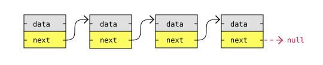
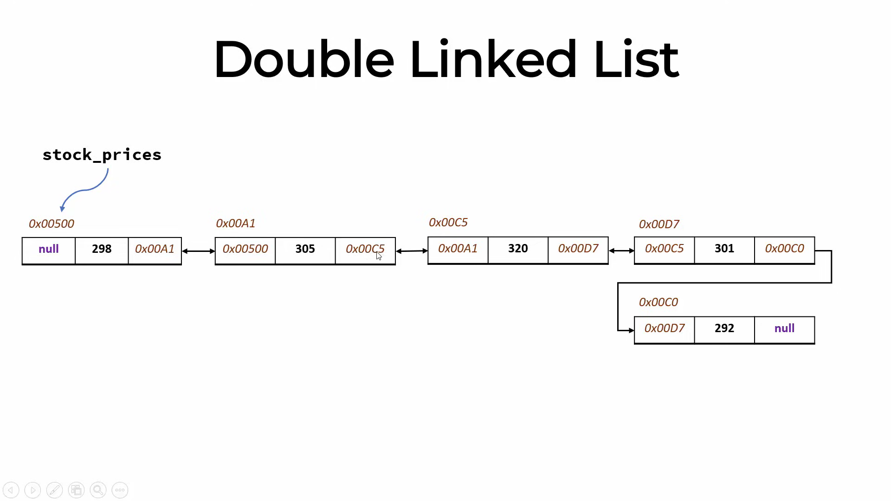

# Data Structure Full Course
This is a repository for all the concepts of [Tariq Elouzeh DS crash crouse on youtube](https://youtu.be/H-bJkwhOBDM using Python.

## Contents
- Chapter 1: [List](#list)
- Chapter 2: [Dictionary](#dictionary)
- Chapter 3: [Linkedlist](#linkedlist)
- Chapter 4: [HashTable](#hashtable)
- Chapter 5: [Set](#set)
- Chapter 6: [Stack](#stack)
- Chapter 7: [Queue](#queue)
- Chapter 8: [Tree](#tree)
- Chapter 9: [Graph](#graph)

For each data structure, we will go through how to create it, then how to traverse through it.

---
## List

Basic array data structure to store multiple values, you can store different types of values: numbers, strings, lists, dicts...etc

type: <class 'list'>

Main attributes:

1) `Ordered`: In general the order of a list is the same, howevere there are a few methods that can change the list's order.

2) `Mutable`: The list is changeable, meaning that we can change, add, and remove items in a list after it has been created.

3) `Allow Duplicates`: Since lists are indexed, lists can have items with the same values.

You can get the length of a list using `len(list)`.


Check and run this [file](src/List/list.py) to see the different ways to traverse through a list:
```bash
python src/list.py
```

Example and visualization:


### Scenario 1: What was the price on day 3?
#### Lookup by index = O(1)

### Scenraio 2: On what day price was 301?
Here we need to go through the whole list via either of the ways we used [here](src/List/list.py), so:
#### Lookup by value = O(N)

### Scenario 3: Print all the prices
Same thing:
#### Array traversal = O(N)

### Scenario 4: Insert new price 999 at index 1:
Using `stock_prices.insert(1, 999)`, since we will be shifting all the elemnts after the index to the nex position so the complexity would be:
#### Array insertion = O(N)

### Scenario 5: Deleting an element at index 1:
Also similiar to insertion, using `stock_prices.remove(1)` so:
#### Array deletion = O(N)


### Check the exercises and their solutions [here](src/List/)
---
## Dictionary

One of the most importnat and widely used data structures in interviews and real-world situations. A dictionary stores data in key-value pairs which is AKA object in other programming languages.

type: <class 'dict'>

Main attributes:

1) `Ordered`: When we say that dictionaries are ordered, it means that the items have a defined order we initalized when creating the dict AKA `insertion ordered`, and that order will not change.

2) `Mutable`: The dictionary is changeable, meaning that we can change, add, and remove items in a dict after it has been created.

3) `Duplicates Not Allowed`: Cannot have two items with the **same key**

---

## Linked List


The same as a regualr list but each element has `two pieces of information`: 1.The value, 2. Pointer for the next value.
Each location in the linked list is called ***Node***.
The first element is called *Head*.

(Head) 100 -> 200 -> 300 -> 400 -> 500 -> None

- Insert element at the beginning = O(1)
- Delete element at the beginning = O(1)

`In the regular list any modification had the complexity of O(N)`

- Insert/Delete element at the `end` = O(n)

### Doubly Linked List

The same as the linkedlist but each Node has an additional piece of information which `previous` that is pointing to the previous node.
---

## HashTable
"Dictionary is the python specific implementation of the hash table" Technically this is all you need to know.

But there is more to it...

A hash table maps keys to values for highly efficient lookups. Under the hood, it uses an array. Instead of searching through every element (which takes O(N) time), it uses a **Hash Function**. 

The hash function takes a key, converts it into an integer, and uses a modulo operator (`hash % size`) to determine the exact index in the array where the value should be stored. This allows us to jump straight to the data.

- Average Insert/Delete/Lookup = **O(1)**
- Worst Case Insert/Delete/Lookup = **O(N)** (if everything collides)

### The Collision Issue
Because array sizes are limited, sometimes the hash function will output the exact same index for two entirely different keys. When this happens, the new data threatens to overwrite the old data. 

To prevent data loss, we use **Collision Resolution Strategies**:

#### 1. Chaining
Instead of storing one value per index, each index in the array holds a List (or Linked List). When a collision happens, the new key-value pair is simply appended to the list at that index.

#### 2. Open Addressing (Linear Probing)
Each index holds only one pair. If a collision happens, the algorithm steps forward to the next available index (`index + 1`) and places the data in the first empty slot it finds. 

Check and run this [file](src/HashTable/hashtable.py) to see both strategies implemented in action, step-by-step:
```bash
python src/HashTable/hashtable.py

---

## Set

---

## Stack

---

## Queue

---

## Tree

---

## Graph

---
