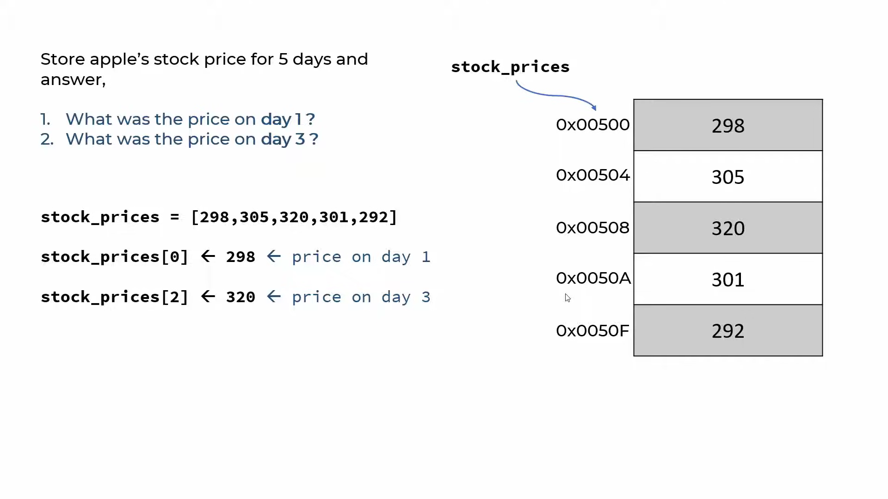

# Data Structure Full Course
This is a repository for all the concepts of [Tariq Elouzeh DS crash crouse on youtube](https://youtu.be/H-bJkwhOBDM using Python.

## Contents
- Chapter 1: [List](#list)
- Chapter 2: [Dictionary](#dictionary)
- Chapter 3: [Linkedlist](#linkedlist)
- Chapter 4: [HashTable](#hashtable)
- Chapter 5: [Set](#set)
- Chapter 6: [Stack](#stack)
- Chapter 7: [Queue](#queue)
- Chapter 8: [Tree](#tree)
- Chapter 9: [Graph](#graph)

For each data structure, we will go through how to create it, then how to traverse through it.

---
## List

Basic array data structure to store multiple values, you can store different types of values: numbers, strings, lists, dicts...etc

type: <class 'list'>

Main attributes:

1) `Ordered`: In general the order of a list is the same, howevere there are a few methods that can change the list's order.

2) `Mutable`: The list is changeable, meaning that we can change, add, and remove items in a list after it has been created.

3) `Allow Duplicates`: Since lists are indexed, lists can have items with the same values.

You can get the length of a list using `len(list)`.


Check and run this [file](src/list.py) to see the different ways to traverse through a list:
```bash
python src/list.py
```

Example and visualization:



### Scenario 1: What was the price on day 3?
#### Lookup by index = O(1)

### Scenraio 2: On what day price was 301?
Here we need to go through the whole list via either of the ways we used [here](src/list.py), so:
#### Lookup by value = O(N)

### Scenario 3: Print all the prices
Same thing:
#### Array traversal = O(N)

### Scenario 4: Insert new price 999 at index 1:
Using `stock_prices.insert(1, 999)`, since we will be shifting all the elemnts after the index to the nex position so the complexity would be:
#### Array insertion = O(N)

### Scenario 5: Deleting an element at index 1:
Also similiar to insertion, using `stock_prices.remove(1)` so:
#### Array deletion = O(N)


### Check the exercises and their solutions [here](src/List/)
---
## Dictionary

---

## Linkedlist

---

## HashTable

---

## Set

---

## Stack

---

## Queue

---

## Tree

---

## Graph

---
